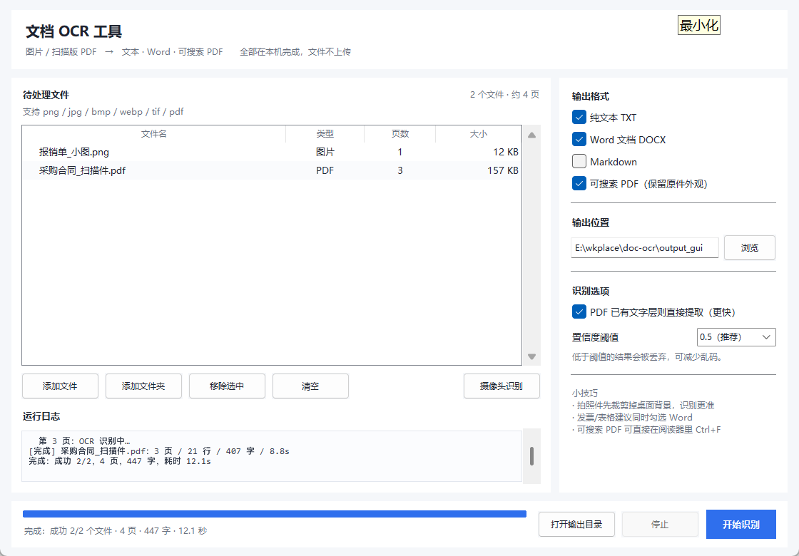
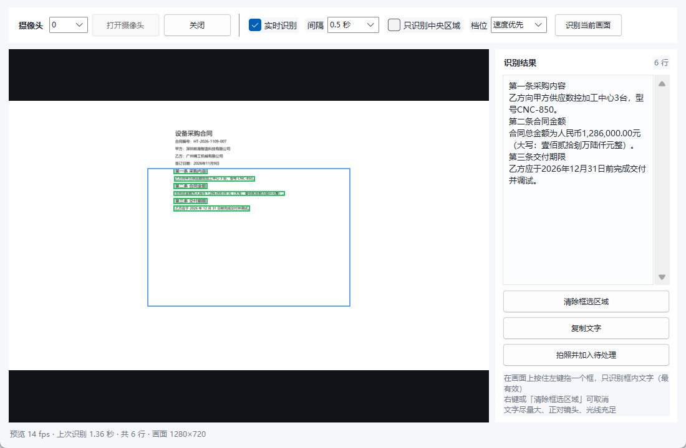

# 文档 OCR 工具

把**图片**和**扫描版 PDF** 批量转成可编辑、可搜索的文档。全部在本机完成，文件不上传。



## 能做什么

- 输入：`png / jpg / jpeg / bmp / webp / tif / tiff / pdf`
- 输出（可多选）：
  - **TXT** 纯文本
  - **DOCX** Word 文档（按页分节，中文字体已设好）
  - **Markdown**（适合再喂给 AI 或做知识库）
  - **可搜索 PDF**：保留原件外观，叠加不可见文字层，能在阅读器里 Ctrl+F 搜索、复制
- 批量处理文件夹（含子文件夹），自动写一份 `识别汇总.csv`
- PDF 已有文字层会智能跳过，不浪费时间重新识别
- 支持拖拽文件到窗口
- **实时摄像头识别**：摄像头画面边看边识别，检测框叠加，可一键取字或拍照存档

## 快速开始

双击 **`run.bat`** 即可启动。

首次在别的机器上部署：

```bash
conda create -n py310 python=3.10 -y
conda activate py310
pip install rapidocr onnxruntime pymupdf python-docx pillow tkinterdnd2 opencv-python
python app.py
```

> RapidOCR 目前不支持 Python 3.13，所以用 3.10 环境；`run.bat` 已指向本机的 `py310`。

## 使用步骤

1. 点「添加文件」或「添加文件夹」，也可以直接把文件拖进窗口
2. 右侧勾选要的输出格式，确认输出位置
3. 点「开始识别」，等进度条走完
4. 完成后会自动提示打开输出目录

## 实时摄像头识别

主界面文件列表下方的「摄像头识别」按钮打开窗口：



1. 选择摄像头序号 → 点「打开摄像头」
2. 勾选「实时识别」，画面里的文字会持续被识别，绿色框标出位置
3. **在画面上按住左键拖一个框**，只识别框内文字 —— 这是提升准确率最有效的手段
4. 右侧实时显示文字，点「复制文字」直接进剪贴板
5. 想归档就点「拍照并加入待处理」，截图会回到主界面列表，和批量文件一起输出

| 选项 | 说明 |
|---|---|
| 实时识别 | 关掉后只在点「识别当前画面」时识别一次，省 CPU |
| 间隔 | 两次识别的最小间隔，识别慢时会被自动拉长 |
| 只识别中央区域 | 只处理画面中间 82% 的区域，行数少、更快 |
| 档位 | 「速度优先」适合实时看；「精度优先」更准但慢一倍左右 |
| 拖拽框选 | 框住目标文字后只识别框内区域，等于变相放大，小字效果提升最明显；右键或「清除框选区域」取消 |

摄像头原生分辨率低（如 640×480）时，程序会先放大到短边 720 再识别。
摄像头识别走「速度优先」参数，批量文件仍用高精度参数，互不影响。

速度参考（CPU，无显卡）：框选一小块文字约 0.6~1 秒；整帧画面 1.3~2 秒。
识别越慢，绿色框停留时间会相应延长，不会出现「框一闪就没了」。

> 摄像头画面是镜像还是正像取决于设备；如果文字是反的，说明画面被镜像了，识别会失败。

## 命令行用法（批量/自动化）

```bash
python cli.py 扫描件目录 -o 结果 -f txt,md,docx,pdf
python cli.py a.pdf b.png -o 结果 --min-score 0.6
python cli.py 扫描件 -o 结果 --no-smart      # 已有文字层也强制重新识别
```

## 性能参考（本机 CPU，无显卡）

| 输入 | 耗时 |
|---|---|
| 520×340 小图（自动放大识别） | 约 3 秒 |
| A4 扫描页（200 dpi 渲染） | 约 3 秒/页 |

模型首次加载约 2 秒，批量处理时只加载一次。

## 目录结构

```
doc-ocr/
├── app.py                 桌面界面（tkinter）
├── core.py                核心逻辑：识别、PDF 处理、导出
├── camera.py              实时摄像头识别窗口
├── cli.py                 命令行入口
├── run.bat                双击启动
├── build_exe.bat          可选：打包成 exe
├── samples/               测试素材（合同扫描件、小图）
├── output/                示例识别结果
└── tools/                 开发调试脚本（生成素材、界面自检）
```

## 实现要点

- **识别**：RapidOCR（PaddleOCR 模型的 ONNX 版），CPU 推理，无需 GPU
- **扫描版 PDF**：PyMuPDF 以 200 dpi 渲染成图 → 识别 → 把文字按坐标以不可见方式写回页面（`render_mode=3`），实现可搜索
- **阅读顺序**：检测器会把一行切成多个框，代码按垂直中心聚类成行、行内按横坐标拼接，并按间距补空格，所以表格能读成“1　数控加工中心　CNC-850　2　428,000.00”
- **小图增强**：最短边不足 960px 时按 LANCZOS 放大，显著改善小字识别

## 常见问题

**识别结果有乱码/漏字？**
把置信度阈值调到 0.3 会多留结果；0.7 更严格。拍照件建议先裁剪掉无关背景、摆正。

**PDF 输出体积很大？**
原始扫描图会原样保留。若要压缩，可在生成后用 PDF 工具降采样图片。

**摄像头打不开？**
确认摄像头没被微信/钉钉/浏览器占用，换个序号再试；窗口重新打开时会自动重扫设备，也可以在设备管理器里检查驱动。

**摄像头识别有点慢？**
勾选「只识别中央区域」把文字摆到框内，识别行数少了自然快；也可以把间隔调到 1 秒，减少重复计算。

**能识别手写体吗？**
印刷体效果好；手写体准确率明显下降，属于模型能力边界。

**双击 run.bat 报一堆「不是内部或外部命令」？**
旧版本批处理用了 UTF-8 编码和 LF 换行，Windows 的 cmd 会按 GBK 解析导致乱码。现已改为纯 ASCII + CRLF，重新双击即可。如果改动过 `run.bat`，请保持 ASCII 编码与 CRLF 换行。

**想做成 exe 发给别人？**
运行 `build_exe.bat`，产物在 `dist/DocOCR/`，整个文件夹一起拷走（含模型）。

## 后续可扩展

- 表格结构化：接 PaddleOCR 的 PP-StructureV3，输出 Excel
- 发票字段抽取：识别后接正则/规则，导出结构化字段
- 批量去水印、自动纠偏：OpenCV 预处理
- 局域网服务化：FastAPI 包一层，浏览器上传识别
