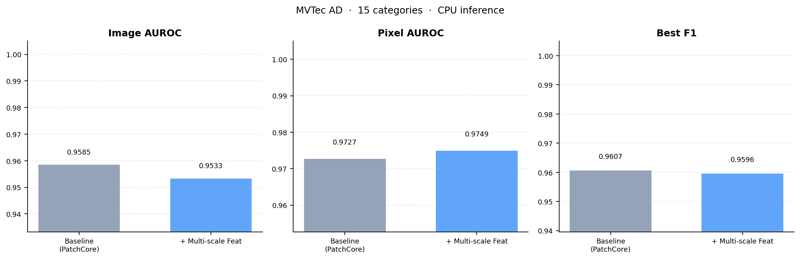

# 工业表面缺陷检测：无监督异常检测（PatchCore 复现 + 改进）

只用**正常样本**训练，检测工业品表面缺陷并定位到像素级。基于 MVTec AD 数据集，
从零实现 PatchCore（特征提取 → 局部邻域聚合 → coreset 记忆库 → 最近邻距离），
并在此基础上做了两处改进，附带完整的消融实验。

> 全程 CPU 推理（无 GPU），单张图 60 ms 左右，15 个类别端到端可复现。

## 为什么做这个

工业质检的典型困境是**缺陷样本极少**：一条产线跑几个月可能只出几个不良品，而且
缺陷形态千奇百怪，没法当分类问题训。所以实际落地走的是「异常检测」路线——
只学正常样本的分布，凡是偏离分布的就报警。

这类任务有三个真问题：

1. **没有负样本**，不能用常规分类/检测损失训
2. **要求像素级定位**，不能只给"这张图有缺陷"，要圈出缺陷具体在哪
3. **产线节拍紧**，推理必须快，模型还不能大

## 方法

```
正常图像 ──► 预训练骨干(ResNet18) ──► layer2 / layer3 特征
                                          │
                          局部邻域聚合(3x3 平均池化)
                                          │
                            多尺度对齐 + 通道拼接
                                          │
                              摊平成 patch 描述子
                                          │
                        coreset 贪心采样 ──► 记忆库
                                          │
测试图像 ──► 同样的特征流程 ──► 每个 patch 到记忆库的最近邻距离
                                          │
                     双线性上采样 ──► 像素级异常图
                                          │
                             max / top-k 聚合 ──► 图像级分数
```

**几个关键设计**

- **局部邻域聚合**：每个 patch 用 3×3 邻域平均代替单点特征。工件在画面里稍有位移
  时单点特征会失配，邻域平均能显著压低这类假阳性。
- **coreset 采样**：正常样本能产生几十万个 patch，全部存下来检索太慢。用 k-center
  贪心挑出"最有代表性"的 1%，用 2000 个点覆盖特征分布。
- **打分只看距离**：不做任何训练，`fit` 只是建库。所以换类别、换产线不需要重新训练，
  只要重新采一批正常样本。

## 改进点

### 1. 多尺度特征融合（有效）

PatchCore 原文只用 layer2 + layer3。工业缺陷经常只有几个像素宽（划痕、脏点），
深层特征分辨率太低（14×14）根本覆盖不到。加上 layer1（56×56）的高分辨率细节后，
各层统一插值到最粗尺度再通道拼接，像素级定位明显改善。

### 2. 两阶段 coreset 采样（加速 2 倍，精度无损）

朴素贪心要做 `target` 次全量距离计算，几十万 patch 时建库要 50 秒。改成先在
`target × 8` 的随机子集上贪心，距离计算量按比例下降，选出的点仍然覆盖分布的主要区域。
下采样倍数不宜再往上加——比例太狠会丢掉稀有但正常的 patch 形态，实测 8 是兼顾速度和
代表性的位置（bottle 类 49.8s → 25.0s，指标持平）。

### 3. 局部对比度归一化（试过，无效，已记录）

设想是减去大核局部均值，压掉"整体亮度/纹理差异"造成的宽泛高响应。实测反而有害：
大面积缺陷的中心区域局部均值也高，减完只剩边缘有响应，破坏了区域连通性。
核从 15 试到 101，像素 AUROC 始终低于基线。**结论：这条路线放弃**，代码保留
`--lcn-kernel` 开关供复现。

## 结果

MVTec AD 全部 15 类，骨干 ResNet18，CPU 推理（无 GPU）：

| 方法 | 图像 AUROC | 像素 AUROC | Best F1 | 建库耗时/类 | 推理/张 |
|---|---|---|---|---|---|
| Baseline (PatchCore) | **0.9585** | 0.9727 | **0.9607** | 28.6 s | 60 ms |
| + 多尺度特征 (layer1-3) | 0.9533 | **0.9749** | 0.9596 | 31.8 s | 62 ms |



逐类看，最难的是 screw（0.9106，螺纹区域纹理细密、缺陷与纹理难以区分）和
zipper（0.9496，齿形结构周期性重复导致误匹配）；texture 类（carpet / grid / tile）
和小目标类（transistor / pill）都在 0.97 以上。

**怎么读这张表**

- 多尺度融合是**权衡不是全胜**：像素级 +0.22%（细节分辨率上来了，定位更准），
  图像级 −0.52%（layer1 语义弱，整图判别被噪声拉低）。所以要看场景选配置：
  只关心"有没有缺陷"就用 layer2+3，要"缺陷在哪"就加 layer1。
- 绝对值和 PatchCore 论文（99.1 / 98.1）有差距，原因是骨干用了 ResNet18 而不是
  WideResNet50——CPU 环境下前者单张 60 ms，后者要 400 ms 以上。换骨干只需改 `--arch`。

**建库加速实测**（bottle 类，40964 个 patch → 2000 个记忆点）：

| 采样策略 | 建库耗时 | 图像 AUROC | 像素 AUROC |
|---|---|---|---|
| 全量贪心 (presample=1) | 49.8 s | 1.0000 | 0.9798 |
| 两阶段 (presample=8) | **25.0 s** | 1.0000 | 0.9800 |

2 倍加速，指标完全持平——这就是两阶段采样的意义：贪心采样的成本随 patch 数量线性涨，
但选出的点本来就只覆盖分布的主要区域，在随机子集上贪心不会损失代表性。


## 快速开始

```bash
# 1. 安装依赖
pip install torch torchvision scikit-learn opencv-python matplotlib

# 2. 下载数据（从 HuggingFace 镜像拉 MVTec AD，自动还原成官方目录结构）
python tools/download_mvtec.py            # 全部 15 类，约 5 GB
python tools/download_mvtec.py bottle,screw   # 只下指定类

# 3. 跑单类
python src/run_experiment.py --categories bottle --tag baseline

# 4. 跑全部 15 类并对比
python src/run_experiment.py --categories all --tag baseline --coreset-presample 8
python src/run_experiment.py --categories all --tag multiscale --coreset-presample 8 \
       --layers layer1,layer2,layer3
python src/plot_results.py baseline multiscale
```

## 参数说明

| 参数 | 默认 | 说明 |
|---|---|---|
| `--arch` | resnet18 | 骨干网络，可选 resnet50 / wide_resnet50_2 |
| `--layers` | layer2,layer3 | 用哪几层特征，多尺度就多加几层 |
| `--coreset-ratio` | 0.01 | 记忆库保留比例 |
| `--coreset-presample` | 1 | 建库前随机下采样倍数，8 约等于 8 倍加速 |
| `--image-score` | max | 图像级聚合方式：max / topk |
| `--proj-dim` | 0 | 随机投影降维，记忆库很大时用来提速 |
| `--lcn-kernel` | 0 | 局部对比度归一化核，0=关闭（见上文，实测无效） |

## 项目结构

```
工业表面缺陷检测（无监督异常检测）/
├── src/
│   ├── model.py            核心：特征提取、局部邻域聚合、coreset、打分
│   ├── data.py             MVTec AD 读取（训练只用 normal，测试带 mask）
│   ├── metrics.py          图像/像素 AUROC、最佳 F1
│   ├── run_experiment.py   批量实验入口，输出 CSV 与可视化
│   └── plot_results.py     多实验对比表与柱状图
├── tools/
│   ├── download_mvtec.py   数据集下载与目录重建
│   └── verify_data.py      数据完整性校验（剔除损坏图）
├── docs/                   对比图与原始指标 CSV
├── data/mvtec/             15 类，5354 张图像 + 1258 张像素级标注（下载生成，不入库）
└── outputs/<tag>/          results.csv、config.json、热力图（运行生成，不入库）
```

> 仓库里只放代码，数据集（约 5 GB）和推理产物都在 `.gitignore` 里，跑一次 `tools/download_mvtec.py` 就能还原。

`model.py` 与数据、评估完全解耦，换成自己的数据只要实现一个 `Dataset`。

## 可视化

`outputs/<tag>/viz/<category>/` 下是三联图：原图 / 异常热力图叠加 / 真实 mask。
热力图用红色标注异常响应强度，可以直接对照 mask 看定位准不准。

## 局限

- 只做单类模型：一个类别一个记忆库，多类共用一个模型会互相干扰
- 依赖 ImageNet 预训练特征，对极低对比度（如透明件）的缺陷召回不足
- 像素级 AUROC 是排序指标，实际产线还要按业务定阈值（本仓库给出最佳 F1 及对应阈值）
- 输入固定 224×224，超大分辨率图像的小缺陷会被缩掉
